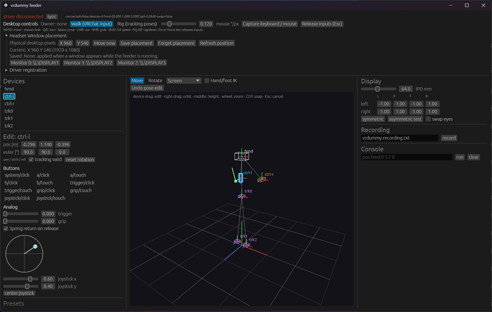

# vr-dummy-headset

SteamVR から認識される仮想デバイス一式（HMD，左右コントローラ，汎用トラッカー）と，
それらを操作するフィーダアプリケーション．VR 環境（主に VRChat）のデバッグ用．

- 設計: [docs/design.md](docs/design.md)
- 座標系: [docs/coordinates.md](docs/coordinates.md)
- IPC プロトコル: [docs/protocol.md](docs/protocol.md)
- 制御コマンド: [docs/control.md](docs/control.md)
- 試験方針: [docs/testing.md](docs/testing.md)
- 統合試験と E2E: [scripts/integration/README.md](scripts/integration/README.md)
- サイトの公開・更新: [docs/publishing.md](docs/publishing.md)

## GUI の画面構成



左コントローラを選択し，FK による腕の編集結果とスティック入力を表示した例．
画像はドライバ未接続の検証画面であり，左上の `driver disconnected` は接続状態を示す．
GUI 内の編集と入力表示は未接続でも利用できるが，SteamVR への反映にはドライバ接続が必要．

| 領域 | 主な操作 |
|---|---|
| 上部：Desktop controls | Walk / Rig の切り替え，キーボード・マウス操作の開始と解除 |
| 上部：Headset Window placement | SteamVR の Headset Window の移動，モニタ選択，位置の保存 |
| 上部：Driver registration | 展開してドライバの登録状態を確認し，登録・解除 |
| 左：Devices / Edit | デバイス選択，位置・角度，ボタン・トリガー・グリップ・円形スティックの編集 |
| 中央：3D ビュー | デバイスのドラッグ移動・回転，手足の IK 編集，姿勢編集の取り消し |
| 右：Display / Recording / Console | 表示パラメータの設定，操作の記録，制御コマンドの実行 |

起動方法とキー操作は [GUI と CLI の使い方](#gui-と-cli-の使い方) を参照．
GUI を表示したまま CUI から操作でき，変更は同じ画面に反映される．

## 実機 HMD（PICO 4 など）と併用するときの注意

ダミードライバは常時「HMD あり」を宣言するため，登録したまま実機の HMD を使うと HMD が
二重になり，どちらが採用されるかは起動順に依存する．

- **実機を使う日は登録を解除する**: `.\scripts\uninstall_driver.ps1`，または SteamVR の
  設定 → スタートアップ/シャットダウン → アドオンの管理 → vrdummy をオフ．
- **実機と併用してトラッカーだけ試す場合**: `driver/resources/settings/default.vrsettings` で
  `hmd_enable: false`，`controllers_enable: false` にする．この構成ではユニバース ID を
  設定しないため，シャペロン（ルームセットアップ）にも影響しない．
- **シャペロンの書き込み**: `vrdummy_probe chaperone`，`vrdummy_e2e`，`vrdummy_viewer` は
  standing 原点 = raw 原点・3 m × 3 m をアクティブな HMD のユニバースに書き込む．実機の
  ルームセットアップを上書きしないよう，アクティブな HMD がダミー（ユニバース ID
  0x5652444D）でなければ拒否する（`--force` で強制）．`steamvr_e2e.ps1` は実行前に
  `Steam/config/chaperone_info.vrchap` を `.tmp/chaperone-backup/` に複製する．
- VRChat 向け既定バインディングは `vrdummy_controller` にのみ適用され，実機のコントローラの
  バインディングには干渉しない．

詳細は [docs/coordinates.md](docs/coordinates.md) を参照．

## 構成

```
driver/                 OpenVR ドライバ driver_vrdummy（C++ / CMake）
driver/tests/host/      ドライバ DLL をフェイク OpenVR でロードする結合試験（SteamVR 不要）
driver/tools/           OpenVR クライアント: vrdummy_probe，vrdummy_e2e（E2E シナリオ），
                        vrdummy_viewer（HMD 内とコンソールにデバイスと入力を表示）
feeder/                 フィーダ（Rust workspace: protocol, core, cli, gui）
third_party/openvr/     OpenVR SDK（サブモジュール）
third_party/doctest/    doctest 単一ヘッダ
tests/fixtures/         プロトコルのゴールデンデータ
scripts/                ドライバ登録・解除，ビルド補助，統合試験手順
docs/                   設計書類
```

## ビルド

### 前提

- Windows 11，Visual Studio 2022（C++ ツールセット，CMake コンポーネント）
- Rust（版は `rust-toolchain.toml` で固定）
- SteamVR（統合試験時のみ）

### 取得

```powershell
git clone --recurse-submodules https://github.com/sabas0ba/vr-dummy-headset.git
```

### ドライバ

```powershell
.\scripts\build_driver.ps1
```

成果物は `driver/build/msvc-x64/vrdummy/` に SteamVR のドライバフォルダ形式で出力される．

### フィーダ

```powershell
cd feeder
cargo build --release
cargo test --workspace
```

## SteamVR への登録

GUI の **Driver registration** に登録状態と **Register / Unregister / Refresh** ボタンを表示する．
**Driver folder** に `driver.vrdrivermanifest` を含むフォルダを指定する．状態は定期更新され，
CUI から変更した登録も反映される．登録状態と実行中のドライバへの接続状態は別表示．

GUI を起動せず，CUI だけで登録・解除することもできる．リポジトリのルートから実行する例：

```powershell
.\feeder\target\release\vrdummy-cli.exe driver status --json
.\feeder\target\release\vrdummy-cli.exe driver register --path driver/build/msvc-x64/vrdummy --json
.\feeder\target\release\vrdummy-cli.exe driver unregister --json
```

登録・解除後は SteamVR を起動または再起動して反映する．アプリによる自動再起動は行わない．
登録済みへの再登録，未登録への解除は変更なしの成功として扱う．
既存の PowerShell スクリプトも使用できる：

```powershell
.\scripts\install_driver.ps1     # 登録
.\scripts\uninstall_driver.ps1   # 解除
```

手順の詳細は [scripts/integration/README.md](scripts/integration/README.md) を参照．

## GUI と CLI の使い方

リポジトリのルートから GUI を起動する．以下は release ビルドの実行例．

```powershell
.\feeder\target\release\vrdummy-gui.exe --config feeder/vrdummy.example.toml
```

GUI を起動したまま，別の端末や AI Agent から同じ設定を指定して操作・状態取得できる．
同じ制御パイプで `vrdummy-cli run` を追加起動する必要はない．

```powershell
# HMD の位置を設定する（単位: m）
.\feeder\target\release\vrdummy-cli.exe --config feeder/vrdummy.example.toml set --json pos hmd 0 1.7 0

# 状態を JSON で取得する（接続・送受信の期限: 3000 ms）
.\feeder\target\release\vrdummy-cli.exe --config feeder/vrdummy.example.toml status --json --timeout-ms 3000
```

`--json` は状態・操作結果を標準出力に返す．状態はフィーダが保持する指令値であり，
SteamVR の実測値ではない．コマンド一覧と終了コードは [docs/control.md](docs/control.md) を参照．

### PC からの移動・視点操作

GUI の **Desktop controls** でモードを選び，**Capture keyboard / mouse** を押す．

| 操作 | キー |
|---|---|
| 前後左右移動 | WASD（Shift で入力を最大にする） |
| 視点回転 | マウス |
| 左右旋回 | Q / E |
| ジャンプ・使用・掴み | Space / 左クリック / 右クリック |
| 上下移動（Rig モード） | R / F |
| 操作解除 | Esc，または GUI がフォーカスを失う |

**Walk (VRChat input)** は左スティック等へ入力を送り，アプリ側の移動機能を使う．
**Rig (tracking poses)** は全デバイスの追跡位置をまとめて動かす．Rig の移動速度は
通常 0.5 m/s，Shift で 1 m/s，上下 1 m/s，旋回 90 度/s．
GUI をフォーカスしたまま Headset Window の映像を見て操作する．VRChat のウィンドウへ
フォーカスを移すと解除される．入力更新が 500 ms 途絶えた場合も解除し，自動再開しない．

### 手・トラッカーと入力の編集

- 中央のデバイスを左ドラッグして移動する．**Move** の隣で画面平面，X/Y/Z 軸，XY/XZ/YZ 平面を選ぶ．
  Ctrl で 5 cm 刻み，Esc でドラッグ開始時へ戻す．**Rotate** は選択軸の回転．
- 右ドラッグで表示の視点回転，中ドラッグで表示の高さ，ホイールで拡大縮小．
- **Hand/foot IK** を有効にすると，手・足を腕／脚の到達範囲に制限して動かす．
  左側の **FK / IK rig** で骨長・体格と FK の関節角を編集する．`trk0` を腰として使う
  簡易編集リグであり，VRChat アバターの骨格を読み取るものではない．**Undo pose edit** で戻す．
- コントローラ選択時の円形スティックをドラッグして方向・量を設定する．
  **Spring return on release** を外すと値を保持する．CUI の変更も円形表示・スライダー・ボタンに反映する．

### Headset Window の位置

GUI の **Headset Window placement** で X/Y（物理ピクセル）を指定して **Move now** を押す．
モニタボタンでそのモニタの左上に移動できる．**Save placement** は位置を保存し，
フィーダ実行中にウィンドウが生成されたときにも適用する．SteamVR だけを起動した場合には
フィーダの保存位置は適用されない．CUI からも同じ操作ができる：

```powershell
.\feeder\target\release\vrdummy-cli.exe set --json window status
.\feeder\target\release\vrdummy-cli.exe set --json window move 100 100
.\feeder\target\release\vrdummy-cli.exe set --json window save 100 100
.\feeder\target\release\vrdummy-cli.exe set --json window forget
```

操作権の取得・更新，FK/IK 等の CUI 構文は [docs/control.md](docs/control.md) を参照．

## ライセンス

Apache-2.0．third_party 配下は各ライセンス（OpenVR SDK: BSD-3-Clause，doctest: MIT）に従う．
