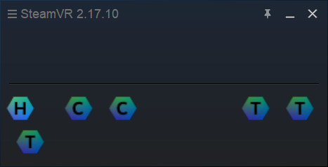
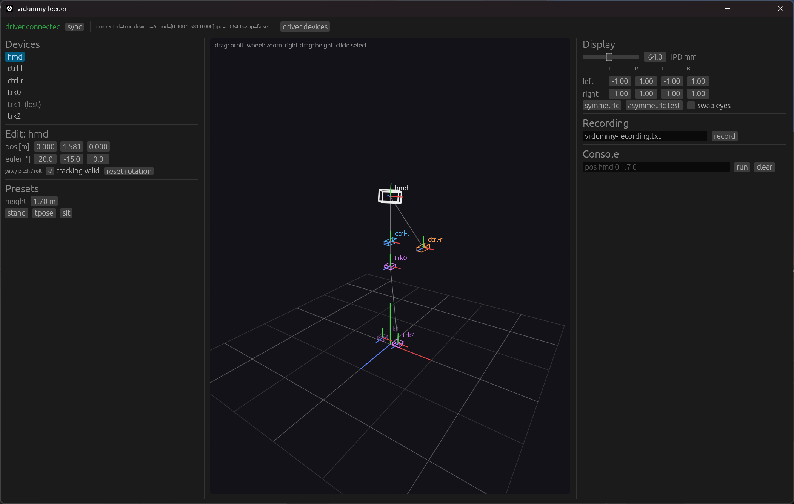
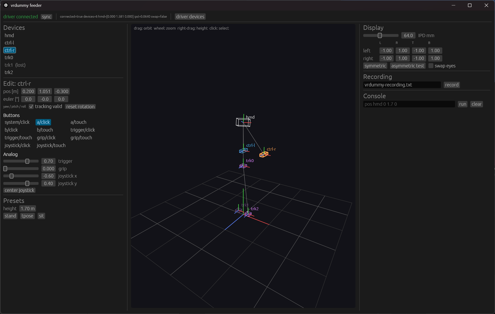
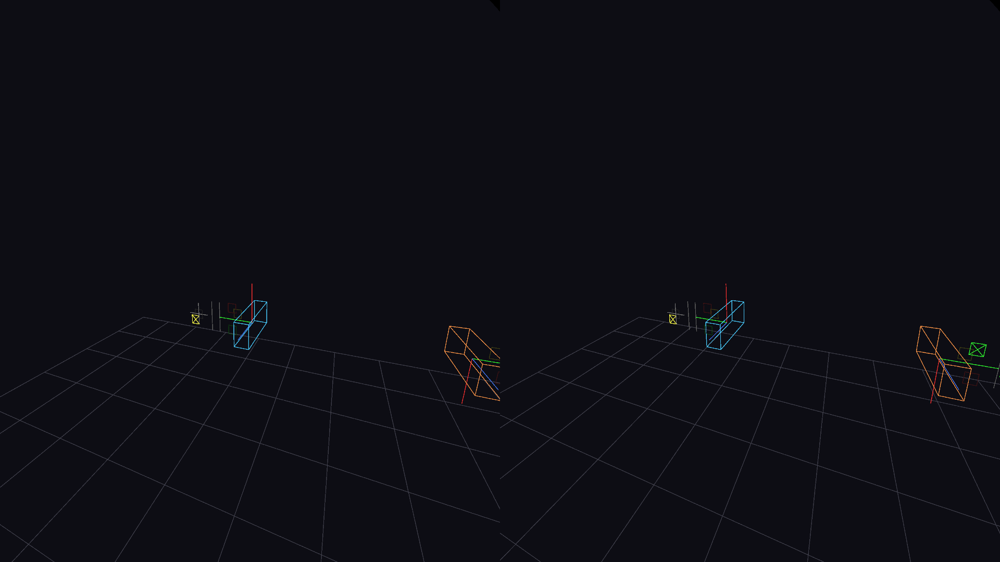

# 動作の全体像（図解）

本書は，仮想デバイス一式が SteamVR 上でどのように見え，どのように操作・検証されるかを
スクリーンショットと実行結果で示す．画像はすべて `scripts/capture_window.ps1` で対象ウィンドウ
だけを撮影したものであり，`docs/images/` に置く．

## 1. 構成

```
 ┌──────────────┐  制御パイプ   ┌──────────────┐  ドライバパイプ  ┌─────────────────┐
 │ vrdummy-gui  │ ───────────▶ │ feeder core  │ ─────────────▶ │ driver_vrdummy   │
 │ vrdummy-cli  │  テキスト     │ (Engine)     │  docs/protocol  │ (vrserver 内)     │
 └──────────────┘  コマンド     └──────────────┘                 └────────┬────────┘
                                                                          │ OpenVR
                                                              ┌───────────┴───────────┐
                                                              │ SteamVR / アプリ       │
                                                              │ vrdummy_viewer, e2e,  │
                                                              │ VRChat                │
                                                              └───────────────────────┘
```

GUI・CLI・シナリオファイルは同じテキストコマンド（`docs/control.md`）を Engine に渡す．
Engine はワールド（全デバイスのポーズ・入力・表示パラメータ）を更新し，ドライバへ送る．
ドライバは SteamVR に HMD・コントローラ 2 台・トラッカー N 台として見える．

## 2. SteamVR から見た仮想デバイス



SteamVR の状態ウィンドウに HMD（H），コントローラ（C）2 台，トラッカー（T）3 台が並ぶ．
フィーダ未接続のときは HMD だけが有効なポーズを持ち，他は追跡外（点滅表示）になる．

`vrdummy_probe list` の出力（フィーダ接続後，`preset tpose` 適用時）:

```text
index=0 class=hmd        serial=VRDUMMY-HMD-0  type=vrdummy_hmd        connected=1 valid=1 result=ok pos=[0.0000 1.5810 0.0000]
index=1 class=controller serial=VRDUMMY-CTRL-L type=vrdummy_controller connected=1 valid=1 result=ok pos=[-0.6970 1.3940 0.0000]
index=2 class=controller serial=VRDUMMY-CTRL-R type=vrdummy_controller connected=1 valid=1 result=ok pos=[0.6970 1.3940 0.0000]
index=3 class=tracker    serial=VRDUMMY-TRK-3  type=vrdummy_tracker    connected=1 valid=1 result=ok pos=[0.0000 0.9010 0.0000]
index=4 class=tracker    serial=VRDUMMY-TRK-4  type=vrdummy_tracker    connected=1 valid=1 result=ok pos=[-0.1000 0.0500 0.0000]
index=5 class=tracker    serial=VRDUMMY-TRK-5  type=vrdummy_tracker    connected=1 valid=1 result=ok pos=[0.1000 0.0500 0.0000]
```

## 3. GUI（vrdummy-gui）



3 列構成で，要素ごとに整理している．

- **左列**: デバイス一覧（追跡喪失中は減光して `(lost)` を付す），選択中デバイスの編集
  （位置 [m]，オイラー角 [°]，追跡有効，回転リセット），プリセット（身長指定で stand / tpose / sit）．
  コントローラを選ぶとボタン群（トグル）と，トリガ・グリップ・スティックのスライダが現れる．
- **中央**: 3D ビュー．床グリッド（0.5 m / 1 m），原点の世界軸（X 赤，Y 緑，Z 青），各デバイスの
  枠と軸，HMD‐腰‐両足・HMD‐両手の骨格リンク，選択中デバイスの強調．左ドラッグで回転，
  ホイールで拡縮，右ドラッグで注視点の高さ，クリックでデバイス選択．
- **右列**: IPD，片目ごとの投影（対称・非対称テスト），左右入替，記録，コマンドコンソール．



ウィジェットの値はエンジンのワールドから毎フレーム読み戻すため，CLI やシナリオで変更した
状態（図では `preset stand 1.7` の後に CLI で設定した HMD の向き，右手の A ボタン・トリガ・
スティック，`valid trk1 0` による追跡喪失）がそのまま表示される．

## 4. HMD 内の表示（vrdummy_viewer）



`vrdummy_viewer` は床グリッド（0.5 m / 1 m），原点の世界軸（X 赤，Y 緑，Z 青），各デバイスの
軸ギズモと枠，コントローラのボタン・トリガ・グリップ・スティックの状態を両眼に描画して
コンポジタへ提出する．図は拡張モードの Headset Window（コンポジタ出力，左右の眼が並ぶ）を
撮影したもので，左手（青）と右手（橙）の枠，左手のスティック位置の指示子（黄），右手の
A ボタン点灯（緑）が見える．このとき GUI 側で非対称投影（`proj -1.2 0.8 -1 1 -0.8 1.2 -1 1`）を
適用しているため，左右の眼で視野の切り取りが異なる．SteamVR の VR ビューでも同じ映像を
確認できる．

コンソールには同じ内容を数値で出力する:

```text
---- frame 366  (pos m, euler deg: yaw pitch roll)
 0 hmd  VRDUMMY-HMD-0    ok       pos=[  0.000   1.581   0.000] euler=[   20.0   -15.0     0.0]
 1 ctrl VRDUMMY-CTRL-L   ok       pos=[ -0.250   1.300  -0.600] euler=[    0.0    -0.0    90.0]
 2 ctrl VRDUMMY-CTRL-R   ok       pos=[  0.250   1.300  -0.600] euler=[    0.0    -0.0   -90.0]
 3 trk  VRDUMMY-TRK-3    ok       pos=[  0.000   0.901   0.000] euler=[    0.0    -0.0     0.0]
 4 trk  VRDUMMY-TRK-4    ok       pos=[ -0.100   0.050   0.000] euler=[    0.0    -0.0     0.0]
 5 trk  VRDUMMY-TRK-5    ok       pos=[  0.100   0.050   0.000] euler=[    0.0    -0.0     0.0]
   left  active=1 a=0 b=0 js_click=0 trigger=0.00 grip=0.00 joystick=[-0.60  0.40]
   right active=1 a=1 b=0 js_click=0 trigger=0.70 grip=0.00 joystick=[ 0.00  0.00]
   eyes: ipd=0.0640  projL=[-1.00 1.00 -1.00 1.00] projR=[-1.00 1.00 -1.00 1.00] dashboard=0 input=1
```

## 5. E2E の結果（SteamVR 2.17.10 実機）

`scripts/integration/steamvr_e2e.ps1` の出力（抜粋）:

```text
== register driver
== start SteamVR
  PASS virtual HMD visible to OpenVR clients
== chaperone: standing origin = raw origin, 3 m x 3 m
  PASS chaperone committed
  PASS calibration ok
== start feeder
  PASS feeder connected to driver
== e2e scenarios
  PASS vrdummy_e2e scenarios            (S1-S8, 127 assertions)
== e2e scenario S9: VRChat default bindings
  PASS VRChat bindings                   (30 assertions)
== scenario file via vrdummy-cli scenario
  PASS scenario completed
  PASS hmd at the scenario's final position
== trackers lose tracking without the feeder
  PASS tracker out of range
  PASS hmd keeps its last pose
== chaperone persists across a SteamVR restart
  PASS calibration ok after restart without re-commit
  PASS play area kept
== result: 0 failure(s)
```

| シナリオ | 検証内容 |
|---|---|
| S1 | 列挙，クラス，左右の役割（`GetTrackedDeviceIndexForControllerRole`） |
| S2 | 全デバイスの静的位置（許容 0.02 m）と HMD のヨー |
| S3 | HMD を 20 段階で 1 m 移動し，観測値が単調に増加して到達 |
| S4 | A/B，トリガ，グリップ，スティック，スティック押下が SteamVR Input のアクションに到達（両手を区別） |
| S5 | IPD 0.07 m で眼の変換が ±0.035 m |
| S6 | `valid trk0 0/1` で追跡外と復帰 |
| S7 | `move` / `euler` / `preset` の連続コマンド |
| S8 | シャペロン較正 OK，standing 原点 = raw 原点，3 m × 3 m，ユニバース ID |
| S9 | VRChat の app key を名乗り VRChat のマニフェストを読み込んだ状態で，move / rotate / jump / interact / grab / menu / trigger_axis が反応 |

## 6. VRChat での利用

1. `install_driver.ps1` でドライバを登録し，SteamVR を起動する．初回のみ `vrdummy_probe chaperone` を実行する．
2. `vrdummy-gui` または `vrdummy-cli run` を起動する（制御パイプを提供）．
3. VRChat を起動する．`vrdummy_controller` 用の既定バインディングがドライバに同梱されているため，
   そのまま移動（左スティック），回転（右スティック），ジャンプ（右 A），インタラクト（トリガ），
   つかむ（グリップ），メニュー（B）が使える．
4. 全身トラッキングは `preset tpose <身長>` で T ポーズにし，VRChat のキャリブレーションを
   両手のトリガ（`input ctrl-l trigger/value 1` と `trigger/click 1`，右手も同様）で確定する．

VRChat の grab はグリップをボタンとして扱い，SteamVR が `grip/value` の閾値から押下を判定する．
`grip/click` だけでなく `grip/value 1` も与えること（GUI のグリップスライダは value を送る）．
